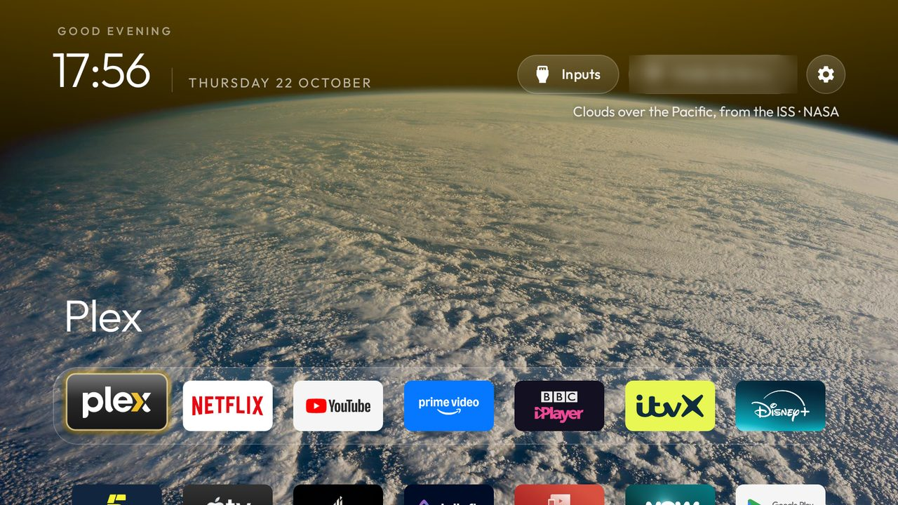
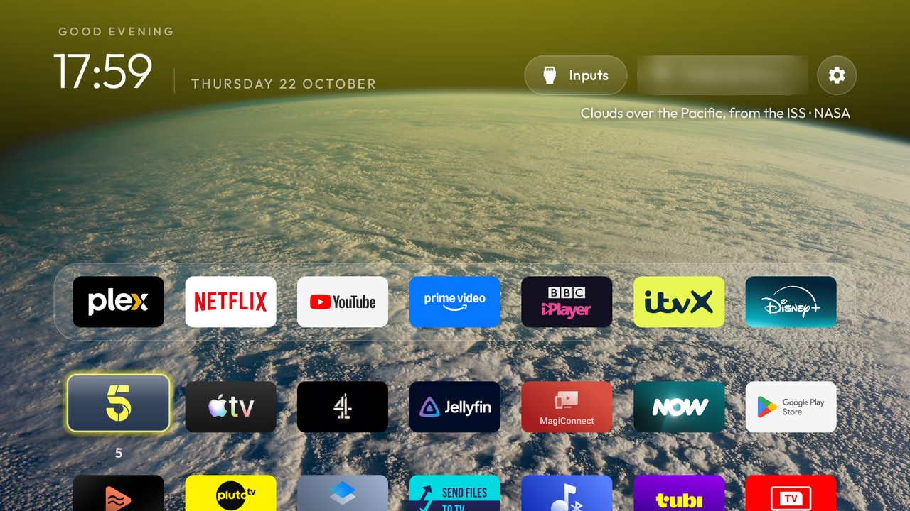
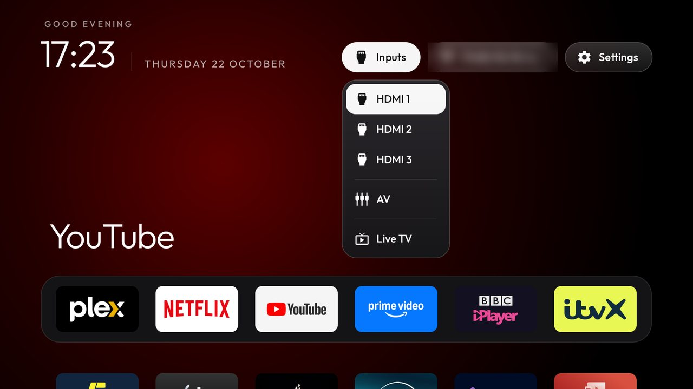

# TCL Smart TV Pro (G03) clean-up

This repo is the debloat lists, launcher theme and scripts for a **TCL Smart TV Pro** on Google TV
(Android 11). It replaces Google TV's ad-filled home screen with a clean, Apple TV-style launcher and a
rotating set of real photographs.



Everything here is built on [**cleanyourtv**](https://github.com/Gathin23/cleanyourtv):
- **Tools:** the ADB tools, with their safety checks.
- **Launcher:** the launcher itself, `com.gathin.tvhome`.
- **Starting point:** the tested list in `examples/tcl-g03-google-tv`.

This repo only adds this TV's choices. Nothing is uninstalled and nothing needs root: every package is
disabled with `pm disable-user` and `./restore.sh` turns it all back on.

| | |
|---|---|
| TV | TCL Smart TV Pro, device `BeyondTV4`, product `G03_4K_GB`, Realtek R51MT05 |
| Software | Google TV on Android 11 (SDK 30), build `RP1A.200622.001` `AR05`, `V8-R51MT05-LF1V508`, UK |
| Remote | IR (`mtkinp`): Netflix, Freeview Play and gear buttons |

## What it does

**Disables 35 packages** in six batches (`lists/`):

| Batch | What |
|---|---|
| 1 telemetry | TCL BI analytics, TCL background reporting, Google feedback |
| 2 content/ads | TCL dashboard, partner promo rows, message box, app showcase, stickers, TCL web-video portal, Google partner auto-installs |
| 3 background | TCL Guard, TCL account, duplicate TCL WebView, WebView shell, calendar sync, Play Games, TCL Gallery, phone-data copier, note reminder |
| 4 apps (by choice) | Google TV / Play Movies, Rakuten TV, the TCL USB media player set, game bar, PVR recording player |
| 5 voice (by choice) | Google voice search and Assistant (the mic button), TCL voice, Alexa, TCL mic manager |
| 6 setup wizard | `setupwraith`, which otherwise takes over Home once Google TV's launcher is off |

Google TV's own launcher (`launcherx`) is disabled by the launcher install, only after the new launcher has
started and owns Home.

**Kept:**
- **Picture and controls:** Live TV, HDMI and AV, TCL's source panel, the remote and Bluetooth, and the keyboard.
- **Google and system:** Play Store and Play Services, Chromecast, screen mirroring, firmware updates and the ambient
  screensaver.
- **Apps:** Netflix, Prime Video, YouTube and YouTube Music, and every app you installed yourself.

All 35 stay disabled after a reboot; this firmware doesn't turn them back on.

**Launcher theme** (`theme/config.json`):
- **Layout:** 7 columns, with Plex, Netflix, YouTube, Prime Video, BBC iPlayer, ITVX and Disney+ in the dock.
- **Look:** a frosted glass dock, a horizon glow, a focus glow in each app's colour, advanced effects,
  icon-only Wi-Fi and Settings buttons, and a tile menu (hold OK to move a tile).
- **Wallpapers:** 20 photographs that change every hour, with a caption giving the place and the credit:
  - 12 landscapes from Wikimedia Commons Featured Pictures;
  - 8 space photos, mostly NASA/ISS. See [CREDITS.md](CREDITS.md).
- **Live TV:** the Inputs menu lists HDMI 1–3, AV and Live TV (`com.tcl.tv`).

**Add-ons installed:**
- **Weather** (upstream `addons/weather`, by [@Sumyabazar1](https://github.com/Sumyabazar1)): a module-card tile showing current conditions, air quality and a 3-day forecast for Biggleswade, from [Open-Meteo](https://open-meteo.com) (no account or API key). Build from upstream and sideload the APK; the launcher asks once to show the card. See [addons/weather/README.md](https://github.com/Gathin23/cleanyourtv/blob/main/addons/weather/README.md).

**Motion:** `focus_overshoot: false` — the focus highlight glides to its target without bouncing past.

 

**Remote buttons:** Netflix, Freeview Play and gear were answered only by Google TV's launcher, so they go
dead once it's off. The theme brings them back through the launcher's `HomeKeyService` helper:

| Button | Key (`mtkinp.kl`) | Now opens |
|---|---|---|
| Netflix | scancode 758 → `TCL_NETFLIX` | Netflix |
| Freeview Play | `KEY_FREEVIEW_PLAY` → `TCL_FREEVIEW_PLAY` | Plex. TCL's handler opens `uk.co.freeview.systemdistributor`, which isn't on this firmware, so the button never worked here |
| Gear | `KEY_SET` → `TCL_SET` (4077) | The launcher's quick settings panel |
| Input | `TV_INPUT` | TCL's own source list (unchanged, no helper needed) |

Holding Volume Up still ramps the volume with the helper on.

## Use it

You need:
- **Git Bash** (on Windows) or any bash shell.
- **Python 3.**
- **A cleanyourtv checkout** next to this repo, with its venv set up.
- **Network ADB on the TV.** Go to **Settings → System → About**, press OK seven times on **Android TV OS
  build**, then turn on **Settings → System → Developer options → USB debugging**. The TV asks you to allow
  the PC the first time it connects.

```bash
git clone https://github.com/Gathin23/cleanyourtv
git clone https://github.com/Willizxy/tcl-tv-cleanup
cd cleanyourtv && python -m venv tools/venv && tools/venv/Scripts/pip install -r tools/requirements.txt && cd ..
```

Then, from `tcl-tv-cleanup`, with your TV's IP:

| Script | What it does |
|---|---|
| `TV_HOST=192.168.1.50 ./debloat.sh` | Disable the six batches, with a screenshot and a pause after each |
| `TV_HOST=192.168.1.50 ./install.sh` | Build and install the launcher as Home, push the theme, turn on the key helper. Needs JDK 17 and Android SDK 34 (`JAVA_HOME`/`ANDROID_HOME`, or a `toolchain/` folder next to this repo) |
| `TV_HOST=192.168.1.50 ./theme.sh` | Push `theme/` again after editing it: no rebuild |
| `TV_HOST=192.168.1.50 ./dns.sh on` | Optional AdGuard Private DNS (blocks most ad and tracker domains, **not** YouTube ads); `off` undoes it |
| `TV_HOST=192.168.1.50 ./restore.sh` | Put everything back to stock. Add `--uninstall-launcher` to remove the launcher too |

**Order on Google TV:**
1. Forget your Wi-Fi network in Settings and join it again. A network saved during first setup belongs to
   `setupwraith`, and disabling the wizard deletes that network. cleanyourtv's `disable.sh` checks this and
   skips batch 6 until you have.
2. Run `./debloat.sh`.
3. Run `./install.sh`.
4. Press the real Netflix, Freeview Play and gear buttons to check them.

When you're done, turn **USB debugging** off and press **Revoke USB debugging authorisations**. Port 5555
is unencrypted.

## Change it

- **Re-enable one app:** on the TV, go to **Settings → Apps → See all apps → Show system apps → (app) →
  Enable**. Or run `tools/tv.py "pm enable <package>"` from cleanyourtv.
- **Dock order or columns:** edit `dock_apps` and `columns` in `theme/config.json`, then run `./theme.sh`.
  On the TV, hold OK on a tile and choose Move.
- **Wallpapers:** put JPGs in `theme/wallpapers/`, ideally 1920×1080, dark and under about 300 KB, and add
  a line for each to `captions.txt` (`file.jpg<TAB>caption`). Then run `./theme.sh`.
  - `wallpaper_rotation_minutes` sets how often the picture changes.
  - `wallpaper_dim` (0–90) darkens it.
  - Every key is described in cleanyourtv's `themes/README.md`.
- **Cinematic top shelf** (`"cinematic_home": true`): fills the top of the screen with the focused app's
  artwork, but hides the wallpaper while the dock is focused. It's off here for that reason.

## Licence

The scripts and docs are MIT ([LICENSE](LICENSE)). The photos in `theme/wallpapers/` keep their own
licences (CC BY-SA, CC BY or public domain), as listed in [CREDITS.md](CREDITS.md).
